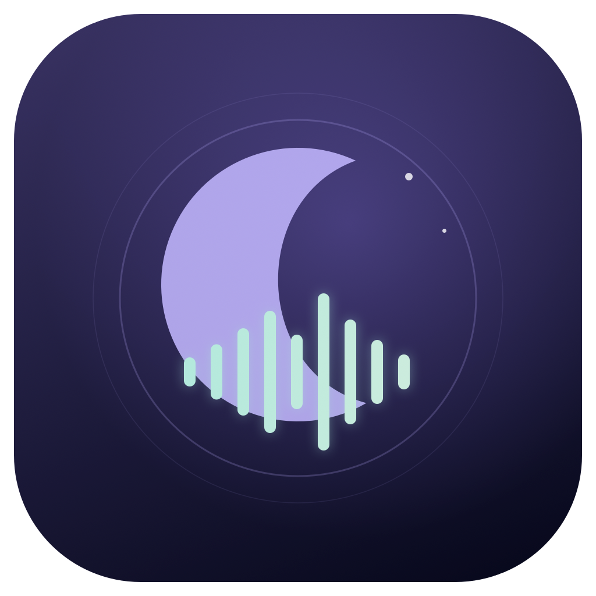

# Nightwave Radio



**A local, instrumental AI radio for Apple Silicon Macs.** Choose a mood, shape the sound, and let YuE2 compose your next track while the current one plays.

## [⬇ Download for Mac — DMG](https://github.com/pnvhome/nightwave-radio/releases/download/v1.3.0/Nightwave-Radio-1.3.0-Apple-Silicon.dmg)

**Version 1.3.0 · Public Beta · Apple Silicon M1 or newer · macOS 26.2+**

Download the ready-to-use app above — no coding or build tools needed. Open the DMG, drag **Nightwave Radio** into **Applications**, then open it and download the music model.

[Installation help](#install) · [Release notes and all downloads](https://github.com/pnvhome/nightwave-radio/releases)

Nightwave is a native SwiftUI app with a dark interface. Music generation runs on your Mac through an embedded MLX-Serve engine. No account, subscription, cloud inference, or separate chat model is required.

> **Non-commercial use:** the application source is MIT, but YuE2 and the included instrumental LoRA are CC BY-NC 4.0. Read [third-party notices](THIRD_PARTY_NOTICES.md) before using or redistributing the complete application.

## Features

- Six stations: Lo-Fi Lounge, Quiet Instrumental, Cyberpunk City, Synthwave Drive, Ambient Space, and Your Station.
- Vinyl, soft beats, beatless textures, space, and darker moods; an optional custom description.
- Instrumental AR LoRA plus the official YuE2 Music Skill score transformation, applied locally.
- Continuous playback with one track prepared ahead, pause, skip, seek, and volume controls.
- Automatic M4A/AAC recording at 256 kb/s, with scores and generation metadata saved alongside.
- Download progress, model-folder selection, and a Finder shortcut.
- Local listening/generation statistics, CPU, memory, whole-Mac GPU, and disk usage.
- Stop releases the app's own music engine. It does not load a Qwen chat model.

## Requirements

- Apple Silicon Mac (ARM64, M1 or newer); Intel is not supported.
- **macOS 26.2 or later** for this packaged backend.
- **16 GB unified memory recommended**. 8 GB is unvalidated and may not have enough free memory.
- About 5 GB for the model, plus the app and recordings.
- Internet for the initial download. Generation works locally afterward.

The build targets Apple M1, but has not been tested on every chip and OS combination. Generation speed varies with hardware, track length, and available memory.

## Install

1. [Download Nightwave Radio for Mac (.dmg)](https://github.com/pnvhome/nightwave-radio/releases/download/v1.3.0/Nightwave-Radio-1.3.0-Apple-Silicon.dmg).
2. Open the DMG and drag **Nightwave Radio** into **Applications**.
3. Launch the app, click **Download model** (about 5 GB), choose a station, and click **Start radio**. If you already have a compatible model, use **Choose model folder** instead.

You do not need to download the source-code ZIP or install MLX-Serve separately.

This community beta is ad-hoc signed, **not Developer ID signed or notarized**. macOS may block the first launch. If you trust the download, follow [Apple's instructions for opening an app from an unidentified developer](https://support.apple.com/102445). Do not disable Gatekeeper globally.

## Where files live

| Data | Location |
| --- | --- |
| New model downloads | `~/Library/Application Support/Nightwave Radio/Models/ddalcu/YuE2-3B-MLX-Serve-8bit` |
| Settings, history, usage, engine log | `~/Library/Application Support/Nightwave Radio/` |
| Recordings and score sidecars | `~/Music/Nightwave Radio/` |
| Selected model folder | macOS preferences for `local.nightwave.radio` |

A complete existing YuE2 model in `~/.mlx-serve/models/ddalcu/YuE2-3B-MLX-Serve-8bit` can be reused without copying. Your explicit folder choice takes priority. Use **Open model folder** to inspect it. Stop playback and downloads before removing a model in Finder. Removing the app does not delete your recordings or model.

## Build from source

See [BUILDING.md](BUILDING.md). This repository contains the complete app, tests, packaging scripts, license notices, and the backend patch. The build fetches the exact upstream source revision and its pinned submodules, rather than requiring a pre-existing MLX-Serve app. Large third-party weights and downloaded build dependencies are kept outside Git.

```sh
brew install cmake webp
# Select a full Xcode installation with macOS SDK >= 26.2 and Metal Toolchain.
export DEVELOPER_DIR="/Applications/Xcode.app/Contents/Developer"
swift test
bash scripts/test-score-tools.sh
bash scripts/build.sh
bash scripts/package-release.sh
```

## Instrumental pipeline and limitations

The native YuE2 AR model writes a score with Mothersuperior's instrumental adapter active (`cot=full`). The official instrumental scripts transfer vocal note events into the instrumental part, preserve musical timing, and validate the result. A separate Nightwave edit shortens exact, consecutive melodic and harmonic repeats lasting at least 60 nominal seconds, retaining about 32 seconds and at least two occurrences. It leaves returning themes, changing harmony and drones alone, revalidates any splice, and records changes in the transfer report. This can shorten a track and does not detect every audible loop. The engine re-tokenizes the transformed score, then runs native MLX semantic generation, NAR synthesis, and VAE decoding. This is not just a “no vocals” prompt.

Score generation is stochastic. Invalid/truncated scores are retried up to three times with fresh seeds; a persistent failure stops the radio and shows an error. The symbolic checks do **not** analyze rendered audio for vocals, and instrumental output cannot be guaranteed for every generation. Duration is a cap, not an exact song-length promise.

## Privacy

No analytics or cloud inference. Downloads contact Hugging Face and its file-delivery infrastructure. The local engine binds to loopback. Prompts, tracks, and usage statistics remain on your Mac. Logs may contain local paths and prompts; review them before sharing an issue.

## Credits

Built on [MLX-Serve](https://github.com/ddalcu/mlx-serve), [YuE2](https://huggingface.co/m-a-p/YuE2-3B), the [official YuE Music Skill](https://github.com/multimodal-art-projection/YuE/tree/main/skills/yue2-music), [Mothersuperior's instrumental AR LoRA](https://huggingface.co/Mothersuperior/YuE2-instrumental-cot-full-loras), and [MLX](https://github.com/ml-explore/mlx). Independent project; no endorsement implied.

Automatic track transitions use a fade of up to three seconds when the next track is ready. Short tracks use a shorter overlap. Manual skipping remains immediate. Recordings are saved without the playback fade.

On a Mac with an audio output device, run playback integration tests with `NIGHTWAVE_AUDIO_TESTS=1 swift test --filter CrossfadeTests`. These use silent local fixtures and do not load a music model.

Start radio immediately plays the newest readable recording made with matching station, sound options, description and requested duration, while YuE2 loads and creates new music. Volume is excluded from matching. Older recordings use their saved request metadata; uncertain matches are skipped.

Use Previous and Next to navigate playback without losing newly generated queued tracks. The player’s recording picker includes search, and every row in Recordings has a play button. Saved tracks can play without loading or installing the model; selecting one during an active radio session keeps generation running. Replaying a recording does not add it to history again or count it as a newly generated track.
